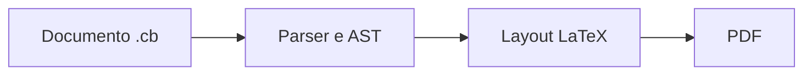

# Carbon

**Escreva documentos científicos em `.cb` e gere PDFs com tipografia LaTeX.**

Carbon é um compilador CLI em Rust. A sintaxe combina títulos e formatação simples com matemática TeX/AMS, tabelas, figuras e diagramas Mermaid. O backend padrão usa Tectonic; o backend nativo `printpdf` permanece disponível para documentos de texto mais simples.

```text
@title Meu primeiro artigo
@author Ana Silva
@date 2 de novembro de 2026

# Introdução
Texto com **negrito**, *itálico* e matemática $E = mc^2$.

$$
f(x) = \frac{\alpha x^2 + \beta}{\sqrt{1+x^2}}
$$
```

## Instalação rápida

### A partir de uma release

Baixe o arquivo da sua plataforma na aba **Releases** do repositório, confira o SHA-256 e extraia a pasta completa. Os pacotes contêm `carbon`/`carbon.exe`, exemplos, documentação, scripts e os manifestos do renderizador Mermaid.

- Windows: execute `carbon.exe`.
- Linux/macOS: execute `./carbon` ou coloque o binário no PATH.
- Instale os runtimes abaixo conforme o documento que pretende compilar.

As releases não incluem Tectonic, Node, Chromium, fontes proprietárias ou caches. O uso local de `carbon --help` e do backend nativo não exige Node.

### A partir do código-fonte

Requer Rust/Cargo **1.88 ou superior**. A CI verifica o mínimo declarado; o desenvolvimento local foi validado com Rust 1.99.1.

```sh
cargo build --release --locked
```

Windows:

```powershell
.\target\release\carbon.exe --help
```

Linux/macOS:

```sh
./target/release/carbon --help
```

Alternativa: `cargo install --path . --locked` instala o binário no PATH do Cargo. As dependências de execução continuam sendo instaladas separadamente.

### Tectonic: composição LaTeX

O backend padrão precisa do [Tectonic](https://tectonic-typesetting.github.io/), versão validada **0.17.0**. No Windows x64, na raiz do projeto ou do pacote extraído:

```powershell
.\scripts\install-tectonic.ps1
```

O script baixa a release oficial e verifica o SHA-256. No Linux/macOS, instale Tectonic com seu gerenciador de pacotes ou com uma release oficial e deixe `tectonic` no PATH.

A primeira composição pode baixar pacotes/fontes TeX para o cache. As seguintes reutilizam esse cache. Para escolher o executável:

```sh
carbon documento.cb --tectonic /caminho/tectonic --output documento.pdf
```

Ordem de descoberta: `--tectonic`, variável `CARBON_TECTONIC`, pasta local `tools/tectonic`, pastas ancestrais do executável Carbon e PATH.

### Mermaid: apenas para documentos com diagramas

Instale **Node >=22.13.0**. O [Mermaid CLI oficial](https://github.com/mermaid-js/mermaid-cli) está fixado em **12.0.0**, com dependências transitivas no lockfile.

Windows:

```powershell
.\scripts\install-mermaid.ps1
```

Linux/macOS:

```sh
sh scripts/install-mermaid.sh
```

Equivalente, válido nos três sistemas:

```sh
npm ci --prefix tools/mermaid
node tools/mermaid/node_modules/puppeteer/install.mjs
```

O segundo comando prepara o Chromium gerenciado pelo Puppeteer, inclusive em versões do npm que bloqueiam scripts de pós-instalação. O download é necessário apenas para preparar esse runtime. Não há `npx` nem instalação automática durante a compilação de um `.cb`.

Um CLI já instalado também pode ser informado:

```sh
carbon documento.cb --mermaid-cli /caminho/mermaid-cli/src/cli.js
```

Ordem de descoberta: `--mermaid-cli`, variável `CARBON_MERMAID_CLI`, `tools/mermaid/node_modules/@mermaid-js/mermaid-cli/src/cli.js` na pasta atual ou junto ao executável Carbon e, em Unix, `mmdc` no PATH. Arquivos `.js`/`.mjs` são iniciados com Node; em Windows use essa entrada JS em vez de wrappers `.cmd`/`.bat`.

Sem blocos Mermaid, Carbon não procura nem inicia esse runtime.

## Compilar um documento

Windows:

```powershell
.\target\release\carbon.exe examples/basico/artigo.cb --output artigo.pdf
```

Linux/macOS:

```sh
./target/release/carbon examples/basico/artigo.cb --output artigo.pdf
```

Com Cargo:

```sh
cargo run --release -- examples/mermaid/diagramas.cb --output diagramas.pdf
```

A pasta de saída deve existir. Sem `--output`, o arquivo é criado ao lado da entrada, com extensão `.pdf`. Uma saída existente é substituída somente após a geração bem-sucedida. O código de saída é `0` em sucesso e `1` em erro; erros de argumentos seguem o comportamento do Clap.

| Opção | Função |
| --- | --- |
| `-o`, `--output ARQUIVO` | Define o PDF de saída. |
| `--backend latex` | Composição LaTeX/Tectonic; padrão. |
| `--backend native` | Renderizador printpdf independente de TeX. |
| `--paper letter` | Papel Letter; padrão do backend LaTeX. |
| `--paper a4` | Papel A4 no backend LaTeX. |
| `--tectonic CAMINHO` | Seleciona o executável Tectonic. |
| `--mermaid-cli CAMINHO` | Seleciona o Mermaid CLI/entrada JS. |
| `--font-dir PASTA` | Fontes TrueType para o backend nativo. |
| `--help`, `--version` | Ajuda e versão. |

O backend nativo mantém A4; `--paper` aplica-se ao backend LaTeX.

## A linguagem `.cb`

Os documentos são texto **UTF-8**, com BOM opcional. LF e CRLF são aceitos. Use uma linha vazia para separar parágrafos. Linhas consecutivas do mesmo parágrafo são unidas por espaços.

Carbon implementa a sintaxe descrita abaixo. Não é uma implementação completa de CommonMark nem um interpretador de LaTeX arbitrário. Listas Markdown, links Markdown, citações bibliográficas, referências de seção/equação e HTML não são recursos implementados nesta versão.

### Metadados

Campos opcionais, um por linha, antes de qualquer conteúdo:

```text
@title Título do artigo
@author Nome do autor
@date 2 de novembro de 2026
```

Campos vazios, duplicados ou desconhecidos geram diagnóstico com número da linha. `@date` é um rótulo livre; não altera o relógio do sistema. Título, autor e data também aceitam formatação inline.

### Títulos e parágrafos

```markdown
# Seção principal
## Subseção
### Tópico

Primeiro parágrafo.

Segundo parágrafo.
```

Os marcadores devem começar na primeira coluna, com um espaço após `#`. O backend LaTeX numera seções automaticamente. O perfil usa `article`, Computer Modern, corpo de 10 pt, margens de 20 mm, texto justificado e recuo de parágrafo. O título do documento é centralizado.

O papel padrão é **Letter**, conforme o artigo de referência. Se a publicação exigir A4, passe `--paper a4`.

### Formatação inline

```text
**Negrito**, *itálico* e ***negrito com itálico***.
É possível aninhar **texto com *ênfase***.
Escapes: \*, \$, \\ e \@ref(fig:literal).
```

Marcadores inline sem fechamento são preservados como texto literal. Referências e matemática podem aparecer em trechos formatados. Caracteres de texto com significado especial em TeX são escapados pelo compilador.

### Matemática e alfabeto grego

Matemática inline usa `$...$`; matemática destacada usa `$$...$$`, em uma linha ou com delimitadores em linhas próprias.

```text
$E=mc^2$, $x_i$, $e^{i\pi}+1=0$ e $\alpha+\beta=\gamma$.

$$
\hat{f}(\xi) = \int_{-\infty}^{\infty} f(t)\,e^{-2\pi i t\xi}\,dt
$$

$$
\begin{aligned}
\nabla\cdot\mathbf{E} &= \frac{\rho}{\varepsilon_0} \\
\nabla\cdot\mathbf{B} &= 0
\end{aligned}
$$
```

Suporte a expoentes, índices, frações, raízes, somas, integrais, limites, funções trigonométricas, vetores e fontes matemáticas. Ambientes: `aligned`, `gathered`, `matrix`, `pmatrix`, `bmatrix`, `Bmatrix`, `vmatrix`, `Vmatrix`, `cases` e `smallmatrix`.

Letras gregas podem ser comandos (`\alpha`, `\beta`, `\Gamma`, `\Omega`) ou caracteres Unicode dentro da matemática (`α`, `β`, `Γ`, `Ω`). Variantes: `\varepsilon`, `\vartheta`, `\varpi`, `\varrho`, `\varsigma`, `\varphi`, `\varkappa`, `\digamma`. Como no LaTeX, use letras latinas para maiúsculas visualmente iguais e `o` para ômicron.

O conjunto permitido de comandos está em `src/latex.rs`. Comandos desconhecidos e chaves desbalanceadas geram erro. Não há acesso a `\input`, `\write`, definição de macros ou execução de comandos do sistema via matemática. Os blocos destacados não recebem número de equação nesta versão.

### Código-fonte

Use cercas com três crases, opcionalmente seguidas de linguagem:

````markdown
```rust
fn energia(m: f64, c: f64) -> f64 {
    m * c.powi(2)
}
```
````

Código indentado com quatro espaços ou uma tabulação também é aceito. A indentação é preservada, tabulações viram quatro espaços e linhas extensas são divididas. Não há realce sintático. A sequência literal `\end{lstlisting}` é reservada pelo backend LaTeX e causa erro dentro de código.

A linguagem `mermaid` nas cercas ativa a renderização de diagramas, descrita abaixo; não é impressa como código.

### Tabelas e legendas

```text
@caption Resultados dos métodos.
| Método | Símbolo | Resultado |
| --- | --- | --- |
| Carbon | $\alpha$ | **Aprovado** |
| Referência | $\beta$ | *Comparável* |
```

A legenda é opcional. Tabelas simples usam `longtable`/`booktabs`: regras horizontais, primeira coluna à esquerda e demais centralizadas, larguras iguais, cabeçalho repetido ao continuar em outra página. Uma linha da tabela não é dividida entre páginas e deve caber na área útil da página.

O separador exige pelo menos três hífens por coluna. Dois-pontos são aceitos, mas não alteram alinhamento. Limite de 12 colunas. Não há células mescladas, escape de `|` ou células que ocupem várias linhas na entrada.

Para dimensões específicas, como no artigo LaTeX original:

```text
@caption Object and star data.
@table width=1 columns=0.48,* align=lc
| Parameter | Value |
| --- | --- |
| Source | 381461681358556480 |
```

`width` e larguras numéricas de `columns` são frações da largura total do texto. Exatamente uma coluna deve usar `*`, para receber o espaço restante. `align` contém um `l`, `c` ou `r` por coluna. O compilador valida larguras, padding e número de colunas. Essas tabelas usam floats `table[htbp]` e `tabularx`; devem caber em uma página. `@table` exige backend LaTeX. Referências com `@ref` nesta versão identificam figuras, não tabelas.

### Figuras e pastas de imagens

```text
artigo/
├── documento.cb
└── figuras/
    ├── curvas/curva de luz.png
    └── vetores/diagrama.pdf
```

No `.cb`:

```text
Veja a Figura @ref(fig:curva), página @pageref(fig:curva).

{#fig:curva width=80%}

@caption Pipeline com **ênfase** e matemática $\alpha$.
{#fig:fluxo width=0.9 page=2 placement=htbp}
```

Formatos: PNG, JPEG (`.jpg`/`.jpeg`) e PDF vetorial. A figura ocupa uma linha própria. A descrição entre `![...]` torna-se a legenda. `@caption` pode substituí-la; a descrição original é mantida na AST. Isso não constitui marcação PDF/UA de acessibilidade.

| Atributo | Comportamento |
| --- | --- |
| `#fig:curva` ou `id=fig:curva` | Identificador opcional, necessário para referência. |
| `width=80%` ou `width=0.8` | Fração da largura útil; padrão 75%, máximo 100%. |
| `placement=htbp` | Aqui, topo, base ou página de figuras; aceita `h`, `t`, `b`, `p` e `!`. |
| `page=2` | Página de um PDF, começando em 1; padrão 1. |

A proporção é preservada. A altura é limitada a 65% da área útil, reservando espaço para a legenda. A posição final é decidida pelo LaTeX; `placement=H` não é suportado. PDF permanece vetorial. PNG/JPEG aceitam apenas `page=1`.

Os caminhos são relativos à pasta do `.cb`, independentemente da pasta em que Carbon for executado ou do destino do PDF. Espaços, subpastas, caminhos absolutos e `../` são aceitos. Prefira `/` para portabilidade. Os arquivos são validados e copiados para nomes internos seguros na pasta temporária; os caminhos originais nunca são inseridos no TeX.

Imagens ausentes/corrompidas, páginas inexistentes e PDFs criptografados geram erro. Limites: 64 MiB por arquivo, 20.000 pixels por dimensão e 256 MiB de alocação na decodificação. SVG, GIF e URLs não são suportados; converta SVG para PDF para preservar vetores.

### Referências cruzadas

```text
Figura @ref(fig:curva).
Página @pageref(fig:curva).
Referência automática: @autoref(fig:curva).
```

As referências são clicáveis e podem vir antes da definição. Funcionam em parágrafos, títulos, legendas e células, inclusive em formatação inline. Não são interpretadas em matemática ou código. `@autoref` inclui o nome do tipo, por exemplo `Figure 2`, preservando o perfil LaTeX em inglês do original.

IDs começam por letra ASCII e contêm apenas letras ASCII, dígitos, `:`, `.`, `_` e `-`, até 100 caracteres. IDs são únicos entre figuras e diagramas Mermaid. IDs duplicados, inexistentes ou referências malformadas são erros. Para escrever a sintaxe literalmente, use `\@ref(...)`.

### Mermaid em Markdown

Use exatamente uma cerca `mermaid`, com os atributos opcionais da figura na abertura:

````markdown
@caption Fluxo de processamento.


Veja a Figura @ref(fig:pipeline).
````

Sem `@caption`, a legenda será `Diagrama Mermaid`. O bloco é renderizado pelo CLI oficial em **PDF vetorial** e incluído como figura com numeração automática. Figuras e diagramas compartilham o contador e o sistema de referências. `width`, `placement` e `#id` funcionam da mesma forma que nas imagens. Diagramas têm uma página; `page` deve ser 1.

Fluxogramas, diagramas de sequência e estados estão nos exemplos e testes. Os demais tipos são interpretados pela versão fixada do Mermaid CLI, conforme os recursos desse runtime. Código Mermaid inválido interrompe a compilação, com diagnóstico do renderizador; não há fallback silencioso para texto.

O renderizador usa tema neutro, fundo branco e `securityLevel: strict`. Configurações `%%{init:...}%%` e front matter YAML são rejeitados para manter o perfil de renderização controlado; use `@caption` e atributos na cerca. O limite é de 50.000 bytes por bloco. A formatação interna do diagrama é sintaxe Mermaid, não Carbon. O renderer/browser externo não deve ser tratado como sandbox para código hostil.

## Exemplos organizados

| Pasta | Conteúdo |
| --- | --- |
| [examples/basico](examples/basico/artigo.cb) | Metadados, seções, texto, código e tabelas. |
| [examples/matematica](examples/matematica/matematica.cb) | Grego, frações, integrais e equações alinhadas. |
| [examples/imagens](examples/imagens/figuras.cb) | PNG, JPEG, PDF, subpastas e referências. |
| [examples/mermaid](examples/mermaid/diagramas.cb) | Fluxograma, sequência e estados. |
| [examples/referencia](examples/referencia/README.md) | Trecho Carbon, `.tex` e PDF originais de comparação. |
| [examples/templates](examples/templates/modelo-cientifico.tex) | Modelo LaTeX independente, mantido como referência adicional. |

Compilar todos os `.cb` após instalar os runtimes:

```sh
python scripts/check-examples.py --binary target/release/carbon
```

Windows: use `--binary target/release/carbon.exe`. PDFs são gravados em `output/examples/`, preservando a organização por pasta. O script usa apenas a biblioteca padrão do Python.

## Backend nativo

```sh
carbon documento.cb --backend native --output documento.pdf
```

O nativo mantém A4, margens de 20 mm, corpo de 11 pt, TrueType incorporado, cálculo de largura e paginação automática. Matemática é texto em itálico; use caracteres gregos Unicode em vez dos comandos TeX. Figuras, Mermaid, referências clicáveis e opções `@table` pertencem ao backend LaTeX.

Fontes descobertas automaticamente:

- Windows: Times New Roman e Courier New em `%WINDIR%/Fonts`.
- Linux: Liberation Serif/Mono em `/usr/share/fonts/truetype/liberation2` (Debian/Ubuntu: `fonts-liberation2`).
- macOS: Times New Roman/Courier New em `/System/Library/Fonts/Supplemental`.

Alternativa: `--font-dir fontes`, contendo `regular.ttf`, `bold.ttf`, `italic.ttf`, `bold-italic.ttf` e `mono.ttf`. Use fontes com licença apropriada para incorporação. Nenhuma fonte proprietária é distribuída no repositório.

## Verificação e desenvolvimento

```sh
cargo fmt --check
cargo clippy --all-targets --locked -- -D warnings
cargo test --locked
```

Com fontes, Tectonic e Mermaid/Chromium instalados:

```sh
cargo test --locked -- --include-ignored
```

Os testes de integração são ignorados por padrão porque requerem esses runtimes. A CI cobre os checks Rust em Windows, Linux e macOS; o job de integração Windows compila todos os exemplos e executa os testes completos. Veja [CONTRIBUTING.md](CONTRIBUTING.md).

Comparação tipográfica opcional, requer `pdfplumber`:

```sh
# Crie tmp/pdfs antes de executar.
carbon examples/referencia/trecho.cb --output tmp/pdfs/comparacao.pdf
python scripts/compare-reference.py
```

A comparação usa as primeiras 24 palavras e as nove regras das tabelas da primeira página. Os motores do original (pdfTeX) e do Carbon (Tectonic/XeTeX) podem apresentar diferenças de codificação/posicionamento no PDF. Não há promessa de identidade binária ou pixel a pixel.

## Estrutura do projeto

```text
src/
  main.rs       CLI, AST, parser, renderizador nativo e saída segura
  latex.rs      Emissão LaTeX, matemática, referências e Tectonic
  figures.rs    Sintaxe, validação e staging de imagens/PDF
  mermaid.rs    Renderização opcional de diagramas vetoriais
examples/       Documentos e assets organizados por assunto
scripts/        Instaladores, checks e empacotamento
.github/        CI e workflow de rascunho de release
tools/mermaid/  package.json e lockfile do runtime opcional
```

A saída é salva usando um arquivo temporário no diretório de destino. Falhas preservam a versão anterior. O compilador impede que a saída sobrescreva o `.cb` ou uma imagem utilizada no documento. Entrada e PDF são mantidos em memória. A paginação é automática; floats podem mudar de página para caber no documento.

Esta versão não possui bibliografia automática, suporte completo a Markdown/LaTeX, shaping de escritas complexas no backend nativo ou certificação PDF/A/PDF/UA. O projeto não passou por auditoria/fuzzing de produção. Para executar como serviço com entrada não confiável, use isolamento e limites de CPU, memória, disco, rede e tempo para Carbon e seus processos auxiliares. Consulte [SECURITY.md](SECURITY.md).

## Publicar uma release

Consulte [docs/RELEASING.md](docs/RELEASING.md). O workflow valida a tag contra `Cargo.toml`, testa e empacota binários Windows x64, Linux x64 e macOS Apple Silicon, com checksums SHA-256. Ele cria **um rascunho no GitHub**, sem publicar automaticamente e sem alterar releases já publicadas.

Carbon usa a licença [MIT](LICENSE). Dependências e runtimes têm licenças próprias; veja [THIRD_PARTY_NOTICES.md](THIRD_PARTY_NOTICES.md) e [CHANGELOG.md](CHANGELOG.md).
